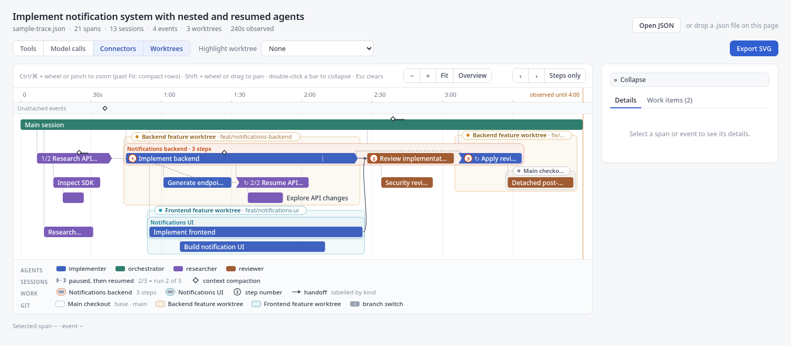
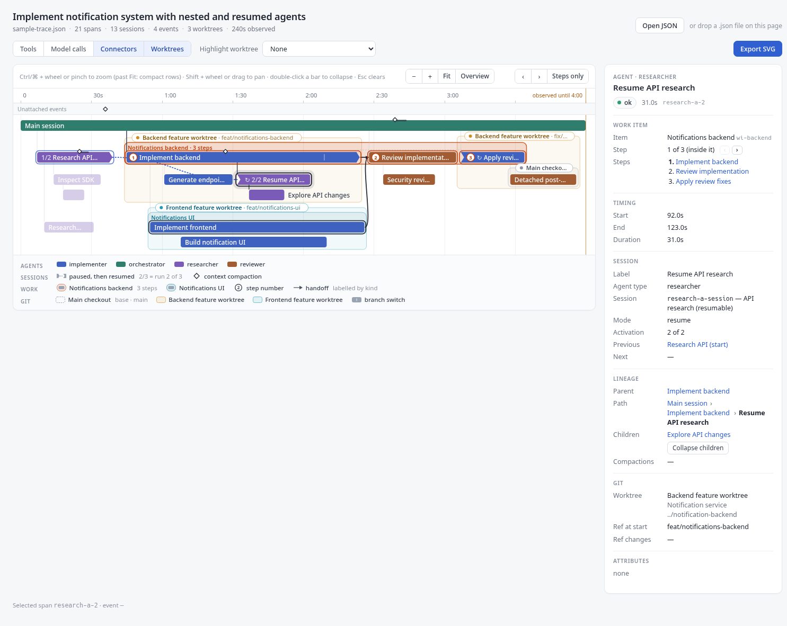
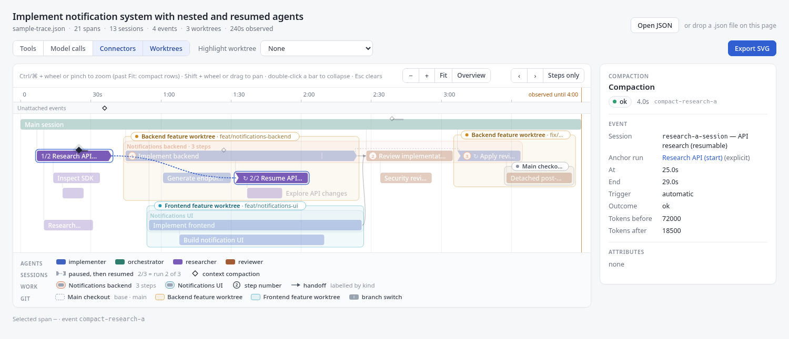
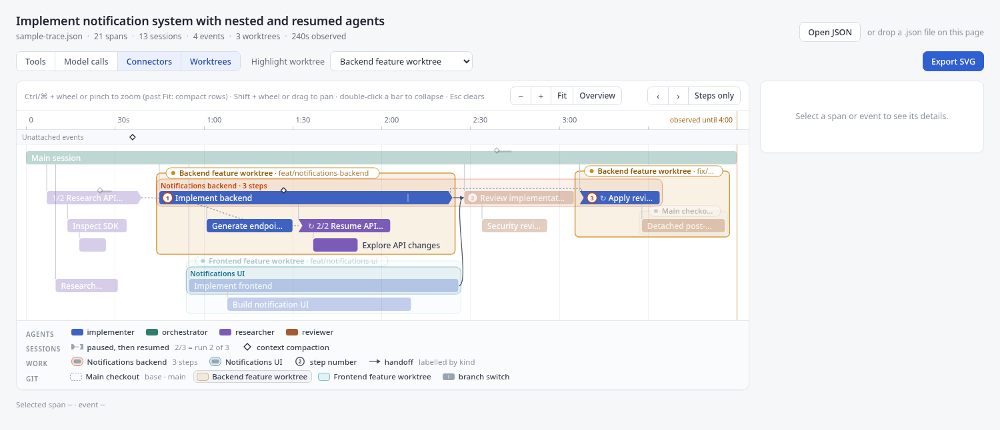
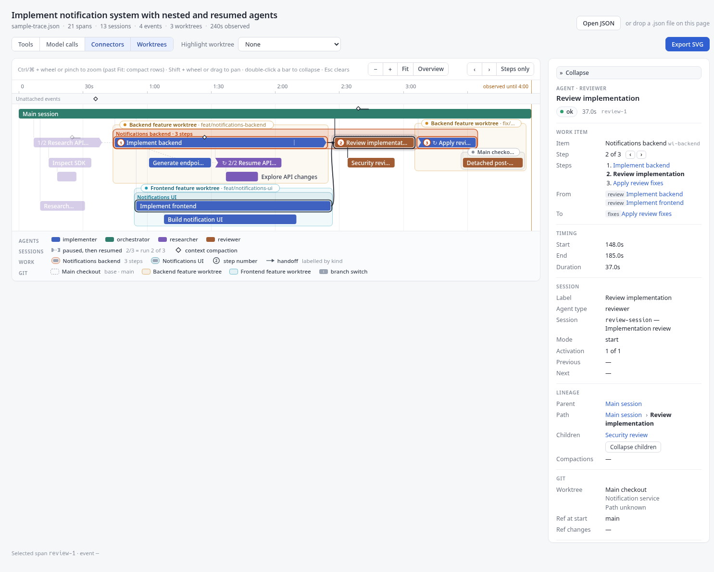
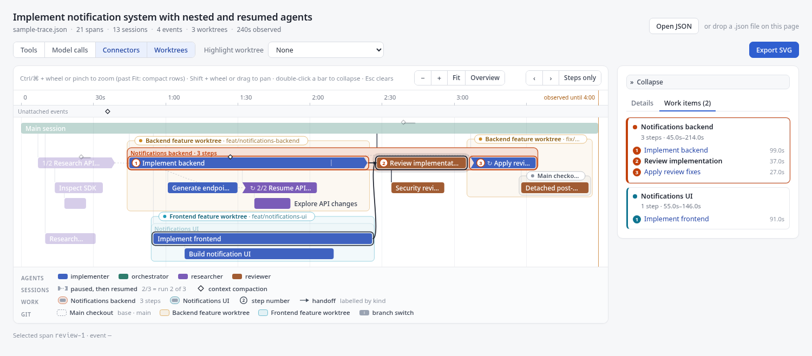

# Work Trace

**Work Trace** is a Svelte 5 / TypeScript component library for visualizing how work unfolded over time: hierarchy, parallel execution, delegation, pauses, resumes and handoffs. Its component, `WorkTimeline`, renders a saved trace as a compact SVG **work execution timeline**. A small offline SvelteKit demo is included.

Today the data model covers AI agent and subagent execution (agent sessions, tool/model calls, compaction, Git worktrees). It records what happened; it is not a Gantt chart or a schedule of future work.

- **X axis = elapsed time.** **Y = dynamic, reusable lanes**: no fixed rows per agent type, session, or depth.
- **Agent type / session / execution span** are kept distinct. A resumed session is a new span (`mode: "resume"`, `resumesSpanId`) linked to its prior activation: chevron/notch run edges, an `n/N` run tag, and a dotted pause link (accented on hover/selection). Parentage (`parentId`) and resume continuity are independent.
- **Compaction** events are markers on the active run, or on an "Unattached events" strip.
- **Git context**: repositories, worktrees, and time-dependent checked-out refs, shown as a **worktree overlay** on the single compact-lane layout. The root span's worktree is the unboxed *base checkout*. Every subtree that runs in a different worktree is packed as a clean rectangle and drawn as a light tinted box behind its bars, with a label chip (`Backend feature worktree · feat/notifications-backend`) on its top border. Hover or click a box or chip to highlight that worktree; toggle the overlay with `showWorktrees`.
- **Scale & zoom**: Ctrl/⌘+wheel or pinch zooms at the pointer, Shift+wheel pans. Zooming out past *Fit time* compacts rows (labels and chips drop out as rows shrink); **Overview** (`9`) fits the whole trace on screen. Runs of tiny tool/model bars become clickable cluster strips. A 7.7k-span trace stays interactive.
- **Work items and handoffs** (optional data: `workItems`, `spans[].workItemId`, `links`): a work item's steps stay on one row where layout allows, on a tinted band with a sticky title and numbered step badges; handoff links are solid arrows labelled with their kind (`review`, `fixes`). Hover or select a span to focus its whole flow; `[` / `]` step through it; **Steps only** collapses each step's internals. A **Work items** tab in the side panel lists the items and their steps; hover one to see it in the chart.
- **SVG export**: self-contained static SVG of the current filter/collapse/overlay state, fit to the full trace, with a header and legend.

Design: [`docs/DESIGN.md`](docs/DESIGN.md) (concepts, JSON contract v3, layout, rendering) and [`docs/DECISIONS.md`](docs/DECISIONS.md) (decision log). JSON Schema: [`src/lib/model/work-trace.schema.json`](src/lib/model/work-trace.schema.json).

| Compact parallel lanes | Resumed session | Compaction details | Worktrees highlighted | Work item flow | Work items list |
|---|---|---|---|---|---|
|  |  |  |  |  |  |

Sample export: [`docs/sample-export.svg`](docs/sample-export.svg).

## Development

Nix provides only the toolchain (Node 22, pnpm, Git); pnpm manages JS dependencies.

```bash
nix develop
pnpm install --frozen-lockfile
pnpm dev        # demo at http://localhost:5173 (loads static/sample-trace.json; open/drop your own JSON)
pnpm check      # svelte-check / TypeScript + pnpm check:layout
pnpm check:layout   # layout invariants on the sample and 2,000 fuzzed traces
pnpm stress-trace   # writes stress-trace.json (7.7k spans, 21 worktrees); open it in the demo
pnpm build      # static demo -> build/, library package -> dist/ (svelte-package + publint)
```

The demo is a fully static site (`adapter-static`): serve `build/` from any static server. Imported traces never leave the browser.

`scripts/capture.mjs` regenerates the screenshots and the sample export via headless Chrome against `build/`.

## Layout

```
src/lib/index.ts        public entry (only supported import path)
src/lib/model/          schema v3 types, JSON Schema, validation, indexes   (pure TS)
                        schema-validator.generated.js: precompiled Ajv validator
                        (regenerate with `pnpm gen:validator` after editing the schema)
src/lib/layout/         deterministic layout + geometry helpers              (pure TS)
src/lib/export/         SVG export (browser)
src/lib/components/     Svelte SVG components (WorkTimeline is public; rest internal)
src/routes/             demo only, not packaged
```

## Public API

```ts
import {
  WorkTimeline,          // Svelte component
  validateTrace,          // (input: unknown) => ValidationResult<WorkTrace>
  exportTimelineSvg,      // (trace, ExportOptions) => string            (browser only)
  type WorkTrace, type WorkTimelineProps
} from 'work-trace';
```

```svelte
<script lang="ts">
  import { WorkTimeline, validateTrace } from 'work-trace';
  let { json }: { json: unknown } = $props();
  const result = $derived(validateTrace(json));
  let timeline: ReturnType<typeof WorkTimeline> | undefined = $state();
</script>

{#if result.ok}
  <WorkTimeline bind:this={timeline} trace={result.value} showWorktrees
    onSpanSelect={(id) => console.log(id)} />
  <button onclick={() => console.log(timeline?.exportSvg())}>Export</button>
{/if}
```

Props: `trace`, `selectedSpanId` and `highlightedWorktreeId` (controlled when supplied), `onSpanSelect`, `onEventSelect`, `onWorktreeSelect`, `showTools`, `showModelCalls`, `showConnectors`, `showWorktrees` (default `true`), `hiddenAgentTypes`. `exportTimelineSvg` takes the same toggles as `ExportOptions`, plus `compactWorkItems` (Steps only). Always validate untrusted JSON with `validateTrace` before passing it in.

Non-Svelte pages can embed an exported SVG as a static image. There is no Web Component or mount API in the MVP.

## Installing in another project (Git, no npm registry)

The package is `private` and is never published. Pin a Git tag or commit:

```bash
pnpm add "work-trace@git+https://github.com/YOUR_ORG/work-trace.git#v0.2.1"
# or a local checkout:
pnpm add "work-trace@git+file:///path/to/work-trace#<commit>"
```

`dist/` is not committed; pnpm builds it from source through the library's `prepack` script (`svelte-package`). **pnpm ≥ 11 blocks Git dependency build scripts by default** (`ERR_PNPM_GIT_DEP_PREPARE_NOT_ALLOWED`). Allow it explicitly in the consumer's `pnpm-workspace.yaml`, using the exact specifier:

```yaml
allowBuilds:
  "work-trace@git+file:///path/to/work-trace#<commit>": true
```

Commit the consumer's `pnpm-lock.yaml`. When you change the pin, update the `allowBuilds` key too.

### Smoke test (manual, done for this release)

In a fresh `sv create --template minimal --types ts` app, outside this repo:

1. Install pinned to a commit, using the `allowBuilds` entry above. pnpm ran `prepack`, and publint reported "All good!".
2. `node_modules/work-trace` contains only `package.json` and `dist/`. No `src/routes`, and no `$app/` or `#lib` imports.
3. A page importing `WorkTimeline` and `validateTrace` and rendering `sample-trace.json` passed `pnpm check` (0 errors) and `pnpm build`. Headless Chrome rendered the SVG (15 `data-span-id` bars).

Re-run on 2026-10-16 with an **empty pnpm store** (`--store-dir` in a fresh temp directory), pnpm 12.9, SvelteKit 3 / Vite 8 (`sv create --template minimal`):
- Newer `sv` templates already write an `allowBuilds:` map (for `esbuild`); add the `work-trace@git+…` key to that map rather than a second `allowBuilds:` block, which is a YAML error.
- `pnpm check` and `pnpm build` passed. In the preview, the timeline rendered 15 bars and `exportTimelineSvg` returned a 30 KB SVG.
- SvelteKit 3 uses `#lib` instead of `$lib` in app code. The library's `dist` uses neither.

## MVP status / not yet done

Implemented and checked manually (headless-Chrome screenshots) plus the automated gates `pnpm check` (svelte-check + layout invariant script) and `pnpm build`. There is no unit-test framework. Deferred: rendering work item nesting (`workItems[].parentId`), agent-type filter UI, collapse-all, text search, a canvas layer for very dense call regions (a zoom step with 1–2k individually visible bars costs ~150–250 ms), and accessibility polish.

Out of scope: live ingestion, editing, a backend, and npm publishing.
